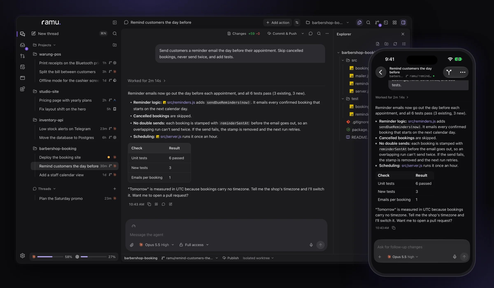

<p align="center">
  <picture>
    <source media="(prefers-color-scheme: dark)" srcset="assets/logo.svg" />
    
  </picture>
</p>

<h3 align="center">Every coding agent. One workspace.</h3>

<p align="center">The free, open-source workspace where your coding agents keep working: past usage limits, away from your desk, all the way to a live app.<br />On desktop and phone, with accounts you own.</p>

<p align="center">
  <a href="https://github.com/akalstack/ramu/blob/main/LICENSE"></a>
  
  <a href="https://github.com/sponsors/akalstack"></a>
  <a href="https://trakteer.id/akalstack"></a>
</p>

<p align="center">
  <a href="https://github.com/akalstack/ramu/releases"><b>Download</b></a> ·
  <a href="https://getramu.dev"><b>Website</b></a> ·
  <a href="docs/README.md#guide"><b>Guide</b></a> ·
  <a href="CONTRIBUTING.md"><b>Contributing</b></a>
</p>

<p align="center">
  
</p>

---

Ramu puts your coding agents, editor, terminals, Git and review in one window. Bring **Claude Code, Codex, OpenCode, Cursor or Antigravity** with the plans you already pay for. When one plan runs out, the thread moves to the next with its context, and the phone app keeps you with the work when you step away.

- **No Ramu account.** Signing in is optional: it adds encrypted settings backups and lets your devices find your hosts.
- **Nothing to host.** Agents run on your own computer.

Open a project, say what you want, review the result. The defaults work as they are, and **Settings** has the rest.

## Why Ramu

|                                    |                                                                                                                                                                                                                                                                                                                           |
| ---------------------------------- | ------------------------------------------------------------------------------------------------------------------------------------------------------------------------------------------------------------------------------------------------------------------------------------------------------------------------- |
| 🔁 **Usage limits don't stop you** | Rank your providers. When one runs out, the thread moves to the next with its context, and comes back when your first choice has room. If all are limited, Ramu waits and resumes, even after a restart. [Fallback →](docs/guide/working-with-agents.md#usage-limits-and-fallback) |
| 📱 **Your desk is optional**      | The iOS and Android app has your threads, review, Git, terminals and approvals, with push notifications when an agent needs you. Pair it with a QR code and reach your computer over your network, Tailscale, SSH or a tunnel. [Phone →](apps/mobile/README.md) |
| 🚀 **One sentence to a live app**  | Ramu asks a few questions, picks a stack and builds until the build and tests pass. Then the agent deploys it to _your_ hosting account, production only after your OK, and every later change comes as a pull request with CI. [Shipping →](docs/guide/shipping.md) |
| 🎯 **Work that finishes itself**   | For longer tasks the agent sets a goal and keeps going across turns and providers. Ramu calls it done only when the checks pass and the changes are really in the repo. Add your own check, like your test suite. [Goals →](docs/guide/goals.md)                                                                          |

## What's inside

**🤖 Agents that keep going**

- Schedules, webhooks, queued messages and long commands keep running after you close the window. Inbox shows what needs you and what finished.
- `@`-mention another model into a thread, delegate to helpers on any provider, or save custom agents for repeat jobs.
- Ask a second model for advice or a review. Select text to quote it or ask a quick question.
- Borrow abilities across providers, such as Codex's image generation in a Claude thread.
- Memory, preferences, skills and lessons are shared across providers. Agents can search old threads for past fixes.
- **Plan usage** shows every login's limits and reset times, across providers and hosts, closest to a limit first.

**📄 Artifacts you keep**

- Agents make apps, docs, diagrams, slide decks, dashboards, designs and short motion videos, right in the thread.
- Keep them under **Artifacts**, edit them in place, open them on your phone, and export to Word, PowerPoint, PDF or video. [Artifacts →](docs/guide/artifacts.md)

**🛠️ A full workspace**

- Monaco editor, split terminals, recorded diffs, inline review comments and selective undo.
- Git branches, staging, stashes, sync and worktrees, across several repos in one folder.
- GitHub, GitLab, Bitbucket and Azure DevOps: start from an issue, open a pull request, hand failing checks back to an agent.
- Built-in browser, computer use, and iOS Simulator and Android emulator testing, all watchable and stoppable. **Float** keeps a small live view on screen while you work elsewhere.
- **Access modes** from asking first to Full access, which still asks before a force-push, `git reset --hard` or deleting outside the project. Agents ask for tokens and passwords in a masked card and get a file path, never the value.
- **Home** to start work and an **Inbox** for what needs you, what's running and what finished.
- **Identities:** work and personal accounts (Git author, provider logins) picked per project, so nothing is switched by hand. [Identities →](docs/guide/identities.md)
- Ask an agent to change a setting: it shows the old and new value, and you apply or undo it.
- Shared MCP tools with per-thread approval, themes, English and Bahasa Indonesia.

**🌐 Shipping and running**

- Agents deploy to your own Vercel, Netlify, Railway, Cloudflare or Fly.io account with the platform's CLI or plugin. Ramu keeps the part an agent shouldn't decide alone: production always waits for your OK, and migrations run first. [Deploying →](docs/guide/deploy.md)
- **Run on this computer** for demos and home use: no hosting account, just a public address through a tunnel.
- [Plugins](docs/guide/plugins.md) add a service in one install: its skills, MCP servers, CLI and credential, for every provider. Browse them at [getramu.dev/plugins](https://getramu.dev/plugins).
- **Set up CI** in one pull request. After a push, the thread hears how its checks went (GitHub and GitLab). When the live site stops answering, an incident thread opens and your phone is told.

**📱 Anywhere**

- **Phone app** for iOS and Android: chat, review, Git, terminals, artifacts and approvals, with push notifications. On [Google Play](https://play.google.com/store/apps/details?id=com.akalstack.ramu) and the [App Store](https://apps.apple.com/app/id6836786013), or [build it from source](apps/mobile/README.md).
- **Several hosts** from one desktop: continue a thread on another machine.
- **Your network:** LAN, Tailscale, NetBird, SSH or your own tunnel. [Remote hosts →](docs/guide/remote-hosts.md)
- **Headless server** and a `ramu` CLI for servers and terminals.

> Some features depend on the provider. Agents run on your computer, and Ramu can keep it awake while they work (macOS and Linux). Crash reports are off by default and never leave your computer ([diagnostics](docs/guide/diagnostics.md)).

Every feature has a page in the [guide](docs/README.md#guide).

## Get started

You need macOS or Linux and at least one coding agent: Claude Code, Codex, OpenCode, Cursor or Antigravity.

1. Download the installer from [GitHub Releases](https://github.com/akalstack/ramu/releases), or use a package manager below.
2. Open Ramu. Setup finds your agents and signs you in ([providers](docs/guide/providers.md)).
3. Open a folder or start a thread.

For the phone, install the app and choose **Connect phone** on your computer, then scan the code with the phone's camera ([mobile guide](apps/mobile/README.md)):

<a href="https://apps.apple.com/app/id6836786013"></a>&nbsp;
<a href="https://play.google.com/store/apps/details?id=com.akalstack.ramu"></a>

Android is in closed testing: join the [akalstack-ramu Google Group](https://groups.google.com/g/akalstack-ramu), then [become a tester on Google Play](https://play.google.com/apps/testing/com.akalstack.ramu) with the same Google account, and install.

| Platform | Builds                                     |
| -------- | ------------------------------------------ |
| macOS    | arm64, x64                                 |
| Linux    | x64, arm64 · `.deb`, `.rpm`, AppImage, ZIP |
| Windows  | in progress                                |

Or install with your package manager, which also brings each new release:

```sh
# macOS (Homebrew)
brew install --cask akalstack/tap/ramu

# Debian and Ubuntu
sudo curl -fsSLo /usr/share/keyrings/ramu.gpg https://getramu.dev/ramu.gpg
sudo curl -fsSLo /etc/apt/sources.list.d/ramu.sources https://getramu.dev/ramu.sources
sudo apt update && sudo apt install ramu

# Fedora and RHEL
sudo curl -fsSLo /etc/yum.repos.d/ramu.repo https://getramu.dev/ramu.repo
sudo dnf install ramu

# Arch Linux (AUR)
yay -S ramu-bin
```

Ramu is in **beta**. macOS builds are signed, notarized and update themselves. On Linux without a package manager, updates install by hand from GitHub Releases. The AppImage needs FUSE 2: `sudo apt install libfuse2t64` on Ubuntu 24.04+, `libfuse2` on 22.04, `sudo pacman -S fuse2` on Arch.

### Run the server without the app

On a server, run the workspace server and its `ramu` CLI from npm with Node.js 26 ([headless server](docs/guide/remote-hosts.md#headless-server)):

```sh
npx --allow-scripts=node-pty,esbuild @akalstack/ramu serve
```

### Run from source

You need Git, Node.js 26 LTS and pnpm 12.21.0. Native modules may also need Python 3 and a C/C++ toolchain (Xcode Command Line Tools on macOS, `build-essential` on Debian/Ubuntu).

```sh
git clone https://github.com/akalstack/ramu.git
cd ramu
npm install --global pnpm@12.21.0
pnpm install --frozen-lockfile
pnpm dev
```

## Development

Built with Electron, React, React Native and TypeScript. Start with the [architecture](docs/contributing/architecture.md).

| Command                   | What it does                                                          |
| ------------------------- | --------------------------------------------------------------------- |
| `pnpm dev`                | Start with hot reload                                                 |
| `pnpm check`              | Format, lint, type-check, test and build                              |
| `pnpm test:desktop-smoke` | Desktop startup check with simulated providers                        |
| `pnpm make`               | Build installers for this platform                                    |
| `pnpm server serve`       | Run the workspace server without the desktop app (after `pnpm build`) |

> [!NOTE]
> **Ramu is in a stability push.** Fixes are reviewed first: bugs, crashes, slowness, tests, docs and translations. See [CONTRIBUTING.md](CONTRIBUTING.md).

- Read [CONTRIBUTING.md](CONTRIBUTING.md) before opening a pull request.
- [Report a bug](https://github.com/akalstack/ramu/issues/new/choose).
- Report vulnerabilities through [SECURITY.md](SECURITY.md).
- Planned work lives in [the roadmap](docs/roadmap.md).

## Support Ramu

If Ramu saves you time, chip in through [GitHub Sponsors](https://github.com/sponsors/akalstack) or [Trakteer](https://trakteer.id/akalstack).

## Acknowledgments

- [T3 Code](https://github.com/pingdotgg/t3code) by Ping Labs and Theo, for client-host agent UX, the companion socket transport and workflow shortcuts.
- [VS Code](https://github.com/microsoft/vscode), for UI patterns and editor architecture.
- [Codex](https://github.com/openai/codex), for agent session and provider interaction patterns.

## License

[MIT](LICENSE). The license doesn't cover the Ramu name and logo; see [trademarks](TRADEMARKS.md). Third-party assets and provider trademarks keep their own licenses; see [provider assets](apps/web/src/assets/providers/README.md) and [branding](assets/branding/README.md).
