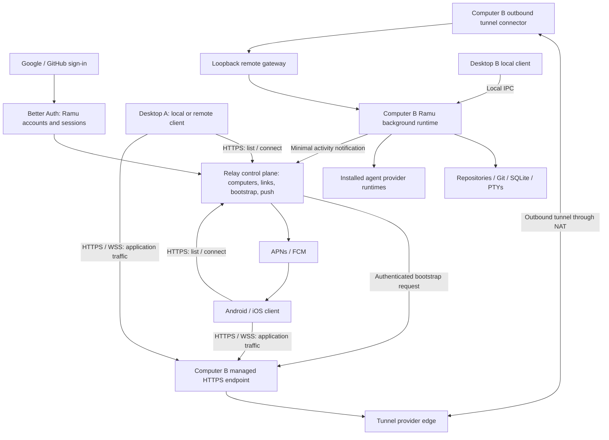

# Mobile and remote computers plan

Status: proposed architecture, not implemented. Updated: 2026-10-12.

## Product decision

Build an Android/iOS companion with **React Native + Expo + TypeScript**. Let every Ramu desktop connect to other computers, and let mobile select any computer linked to the same Ramu account through Google or GitHub sign-in.

Use **Better Auth** for Ramu account authentication, hosted in the relay backend with PostgreSQL. Its Google/GitHub providers and official Expo/Electron integrations fit the proposed clients. T3's Clerk integration remains a reference for the architecture, not Ramu's selected authentication dependency.

Follow the existing Ramu hierarchy: **Home → Project → Chats**, with files, reviews, terminals, goals, and schedules belonging to the selected computer. Add a computer picker rather than introducing a second workspace model. The computer running a repository owns its files, agent processes, provider credentials, and database.

Example: a MacBook and a Linux workstation are linked to one account. On the MacBook, select the workstation to chat with its agents and review its changes. On an iPhone or Android phone, select either computer and continue the same chats. Each computer can be a client and a host at the same time.

This is remote access to Ramu, not screen sharing or automatic repository synchronization. Selecting another computer does not move an agent or copy a checkout.

## Reference: T3 Code

Reviewed the official [pingdotgg/t3code repository](https://github.com/pingdotgg/t3code) at commit [`701fc831`](https://github.com/pingdotgg/t3code/tree/701fc83169611473139c441bc27d5ded9612dc8d). This is the official source, rather than an unofficial Android wrapper. Source documentation can lag published builds; the findings below describe the reviewed source.

| Evidence | Finding | Ramu decision |
| --- | --- | --- |
| [Mobile dependencies](https://github.com/pingdotgg/t3code/blob/701fc83169611473139c441bc27d5ded9612dc8d/apps/mobile/package.json), [mobile README](https://github.com/pingdotgg/t3code/blob/701fc83169611473139c441bc27d5ded9612dc8d/apps/mobile/README.md) | React Native/Expo, shared TypeScript packages, and native modules; development builds rather than Expo Go | Use the same broad stack, with a smaller initial feature set and standard components |
| [T3 Connect architecture](https://github.com/pingdotgg/t3code/blob/701fc83169611473139c441bc27d5ded9612dc8d/docs/internals/t3-connect.md) | Clerk cloud identity, linked environments, managed tunnels; normal application traffic bypasses the relay Worker | Separate account/discovery from host application traffic |
| [Environment authentication](https://github.com/pingdotgg/t3code/blob/701fc83169611473139c441bc27d5ded9612dc8d/docs/internals/environment-auth.md) | Host-issued scoped sessions, proof-bound bootstrap, and short-lived WebSocket tickets | Enforce remote permissions on the host; account login alone is not a host session |
| [Relay README](https://github.com/pingdotgg/t3code/blob/701fc83169611473139c441bc27d5ded9612dc8d/infra/relay/README.md) | Relay also handles mobile registrations and notification delivery | Include push notifications, with minimal payloads |
| [Mobile navigation](https://github.com/pingdotgg/t3code/blob/701fc83169611473139c441bc27d5ded9612dc8d/docs/internals/mobile-navigation.md) | Includes custom native navigation behavior and dependency patches | Start with standard navigation; add native customization only for demonstrated Ramu needs |

Use these architectural ideas as references. Do not import its full dependency graph or assume its internal protocol is a stable external API. If implementation code is reused, retain the applicable MIT license and attribution.

## Mobile stack choice in 2026

These are project-specific judgments, not a universal framework ranking. Pin a supported stable Expo/React Native combination when implementation starts; do not copy a release candidate from the reference repository.

| Stack | Android + iOS approach | Fit for Ramu | Decision |
| --- | --- | --- | --- |
| **React Native + Expo** | Shared TypeScript logic and React Native UI, with native integration where needed | Existing React/TypeScript team and domain code; good fit for chat, reviews, notifications, and host selection | **Recommended** |
| Flutter | Shared Dart logic and Flutter UI | Good alternative for a team comfortable with Dart; requires a new language and separate domain implementations | Second choice if Flutter expertise outweighs TypeScript reuse |
| KMP + Compose Multiplatform | Shared Kotlin logic and optionally shared Compose UI | Viable production option; strongest fit for a Kotlin-oriented team | Choose if Kotlin becomes the team's main mobile expertise |
| KMP + SwiftUI + Android Compose | Shared Kotlin logic, separate native UIs | Strong native integration, but two UI implementations | Choose if platform-specific UX justifies the additional work |
| Swift/SwiftUI plus Kotlin/Compose | Separate native apps | Maximum platform control; highest duplicated UI and integration work for this team | Avoid for the first cross-platform release |
| Swift with Android SDK | Swift can target Android; Apple's SwiftUI does not supply the Android UI | Adds UI/tooling choices without matching Ramu's existing expertise | Do not choose simply because Swift now runs on Android |

Current primary sources: [React Native recommends a framework such as Expo](https://reactnative.dev/docs/environment-setup), [Expo development builds support custom native code](https://docs.expo.dev/develop/development-builds/introduction/), [Flutter platform integration](https://docs.flutter.dev/platform-integration), [KMP/Compose platform stability](https://kotlinlang.org/docs/multiplatform/supported-platforms.html), [Swift Android SDK](https://www.swift.org/documentation/articles/swift-sdk-for-android-getting-started.html), and [Apple SwiftUI platform scope](https://developer.apple.com/swiftui/).

Share protocol schemas, validation, event reducers, provider labels, localization, and pure helpers. React DOM, shadcn desktop components, Electron IPC, Monaco, and xterm.js are not directly reusable native mobile UI. Preserve their behavior and terminology through mobile components.

Use an Expo development build from the beginning. Start with standard native navigation, a virtualized transcript, secure credential storage, and notifications. Validate long chats, Markdown/code blocks, keyboard behavior, and diffs on physical Android and iOS devices before committing to specialized renderers.

## How the components connect



The relay name covers account and connection services. In the recommended design it is a **control plane**, not a custom server forwarding every terminal byte. The tunnel provider still transports normal traffic; bypassing the relay API is not peer-to-peer networking.

Both desktop and mobile use the same remote host API. A target host needs no router port forwarding: its tunnel connector initiates outbound connections. Remote desktop access means using Ramu operations on another computer, not controlling that computer's entire graphical desktop.

### Responsibilities and suggested stack

| Component | Owns | Initial stack |
| --- | --- | --- |
| Desktop | Existing workspace UI, computer picker, local and remote transports | Existing Electron/React/TypeScript |
| Mobile | Host selection, chats, questions, reviews, drafts, notifications | React Native/Expo/TypeScript |
| Host runtime | Agents, files, Git, terminals, schedules, goals, durable chat events | Existing Node/TypeScript runtime and local SQLite |
| Remote gateway | Authentication, scoped RPC, subscriptions, attachments, host sessions | Node/TypeScript loopback service beside the runtime |
| Account service | Google/GitHub identity, linked login methods, account sessions | Better Auth in the TypeScript relay backend, backed by PostgreSQL |
| Relay control plane | Account-to-host links, bootstrap, endpoint lifecycle, push registration | TypeScript service + PostgreSQL; one deployment initially |
| Managed tunnel | Reachability through NAT, TLS endpoint, connector lifecycle | Evaluate Cloudflare Tunnel first, following the T3 pattern |

Keep relay deployment separate from desktop/mobile releases, with versioned APIs. The control-plane implementation need not copy T3's Cloudflare Worker/Effect/PlanetScale deployment. Verify current tunnel terms, provisioning limits, costs, connector redistribution, and authentication SDK support before choosing production providers.

### Better Auth integration

- **Backend:** configure Google and GitHub social providers and persist Better Auth users, provider accounts, and sessions in PostgreSQL. Map the authenticated Better Auth user ID to Ramu's internal `accountId`; do not confuse it with a provider-account record ID. Keep auth tables distinct from Ramu host/link/device tables.
- **Mobile:** use the official [`@better-auth/expo` integration](https://better-auth.com/docs/integrations/expo), system-browser social sign-in, validated app callbacks, and secure session storage. Test callbacks on installed Android/iOS builds.
- **Desktop:** use the official [`@better-auth/electron` integration](https://better-auth.com/docs/integrations/electron) with system-browser sign-in. Keep credential handling in the main process and expose only narrowly scoped authentication actions through preload. Validate compatibility with Ramu's pinned Electron version and packaged protocol handling.
- **Linking:** allow explicit linking through `linkSocial()` and set `account.accountLinking.disableImplicitLinking: true`. Handle same-email `account_not_linked` responses by directing users to sign into their existing account and link from Settings. Support differing Google/GitHub emails only through the authenticated explicit-link flow. See [Better Auth account linking](https://better-auth.com/docs/concepts/users-accounts).
- **Host access:** validate Better Auth sessions at the relay API. Host discovery, ownership checks, device proof keys, relay-signed bootstrap grants, and host-issued sessions remain Ramu services. Better Auth social login does not provide the host transport or the proposed DPoP protocol automatically.
- **Operations:** Ramu owns auth deployment, database migrations/backups, secrets, rate limits, and security updates. Propagate account/session revocation to related Ramu device grants and host sessions; revoking a Better Auth session alone does not close an independently authenticated host socket.

Pin compatible Better Auth/core integration versions during stage 0. Prove Google and GitHub sign-in, explicit linking, logout/revocation, and packaged desktop/mobile callbacks before implementing the full connection flow.

## Account and computer enrollment

1. Sign into Ramu using Google or GitHub. The identity layer maps this login to one internal `accountId`.
2. On a desktop, enable **Settings → Connections → Allow remote access**. Local-only use continues to work without an account.
3. The runtime creates a persistent host identity and signing key. Register a stable `hostId`, display name, platform, capabilities, and public key under the account.
4. Provision the managed endpoint and store tunnel credentials in protected host storage. Start a supervised outbound connector to the validated loopback gateway.
5. Other signed-in clients automatically list the computer, including offline computers. Show **Online**, **Offline**, or **Reconnecting** and last-seen time.
6. Selecting a computer requests a short-lived bootstrap grant. The target host verifies the account link and issues its own scoped session.

Google and GitHub logins do not automatically mean the same Ramu account. Offer explicit **Link another sign-in method**, requiring authentication to both identities. Never merge accounts only because email addresses match. Use stable provider subjects/IDs rather than email or GitHub username as identity keys.

Use browser/system authentication with authorization-code/PKCE where applicable, with state and validated redirects. Keep provider secrets on the backend and exchange identity for Ramu credentials. Reference [OAuth for native apps](https://www.rfc-editor.org/info/rfc8252/), [Google installed-app guidance](https://developers.google.com/identity/protocols/oauth2/native-app), and [GitHub OAuth/PKCE guidance](https://docs.github.com/en/apps/oauth-apps/building-oauth-apps/authorizing-oauth-apps).

Provider account sign-in for Claude, Codex, and other coding agents remains on each host. Ramu's Google/GitHub login does not authenticate those providers or grant repository permissions on GitHub.

## Remote session and permission boundary

Use the T3-style separation between cloud identity and host authority:

1. Client authenticates to the relay and proves possession of a device key.
2. Relay checks account ownership of the requested host and contacts only its recorded, managed endpoint.
3. Host validates a bounded signed relay request containing host/account identity, nonce, expiry, and client proof key. It returns a signed, short-lived, single-use bootstrap credential.
4. Client redeems that credential with proof of its key at the host gateway. The host issues a session bounded by its remote-access policy.
5. Client uses authenticated HTTPS and short-lived WebSocket tickets to fetch state and subscribe. Never put a long-lived session token in a socket URL.

Use established OAuth/DPoP/token libraries and review the protocol before external beta; this is a design outline, not a bespoke cryptographic specification. Relay signing authority is trusted for account-based access. DPoP limits stolen-token replay; it does not eliminate a compromised relay's authority.

The gateway must explicitly allowlist remote operations. Do not expose the current unrestricted local dispatcher over TCP. Enforce capabilities such as read workspace, operate chats, respond to questions, review changes, write files, operate Git, and use terminals on every request/subscription. Agent operation also needs a provider execution-mode ceiling: a read-only client must not launch a full-access agent to bypass its grant.

Remote access is opt-in on each host. The owner can enable the normal working capabilities once; avoid a new connection-confirmation prompt on every use. Default remote grants exclude credential export, new access grants, host account changes, and relay administration. Show trusted devices and provide revocation. Logout, unlink, and revocation must invalidate relevant active host sessions and close live sockets, not just hide a computer from the list. Require periodic link revalidation with a bounded authorization lease so disconnected hosts cannot retain revoked cloud access indefinitely.

The remote gateway enforces canonical workspace paths, symlink checks, attachment limits, and request limits. Local provider MCP endpoints remain loopback-only and are not exposed by the tunnel. Validate managed endpoints against recorded allocations, reject arbitrary URLs/redirects during bootstrap, and prevent the relay from becoming an arbitrary network proxy.

TLS protects transport, but a TLS-terminating tunnel provider can potentially see application content. Do not describe this MVP as end-to-end encrypted or zero knowledge. Application-level encryption with verified host keys is a separate possible project. Keep prompts, code, tokens, and terminal contents out of relay logs; push payloads should contain a generic status and opaque host/chat identifiers.

## Mobile flow: familiar Ramu, fewer steps

| Surface | Mobile behavior |
| --- | --- |
| First launch | Google/GitHub sign-in → linked computers; empty state explains how to enable Connections on desktop |
| Computer picker | Available from Home and workspace headers; remembers the last selected computer and clearly identifies the active one |
| Home | Selected computer's recap, waiting questions, working chats, and next schedules; optional cross-computer attention list links directly to the owning host |
| Project | Same project and repository grouping as desktop; one list of sibling chats, including isolated-worktree labels |
| Chat | Transcript and composer first; same provider/model/mode language, steering, queue, Stop, and supported questions |
| Files and reviews | Open from chat/workspace actions into focused screens; readable diffs, changed-file list, and comments returning to the owning chat |
| Schedules and goals | Same host-owned semantics as desktop; compact list/detail screens |
| Settings | Account and sign-in methods, Connections, notifications, appearance, and language; host-specific settings clearly identify their computer |

On phones, use one main screen at a time with standard Back behavior. On tablets, allow a project/chat sidebar with a detail pane. Carry Ramu's branding, accent colors, typography, English/Indonesian terminology, and native accessibility through both platforms.

Keep attachments available in the composer. Show outstanding questions inside the chat and from Home, without creating a separate task system. Selecting a notification opens the correct host/project/chat and pending question. Restore navigation, draft text, and scroll position when returning from a file or review.

Aim to improve simplicity through measurable outcomes: a linked user can open the last chat immediately; a waiting question is reachable from Home in one action; host context remains visible; a file review returns to the same chat. Avoid exposing tunnels, tokens, endpoints, and session scopes in ordinary screens. Put connection diagnostics behind Settings.

## Reliability and simultaneous clients

- **Host is authoritative.** State stays in its SQLite database and files. Cloud storage keeps account/link/device metadata rather than mirroring repositories and complete transcripts.
- **Host-qualified IDs.** Route and cache by `hostId` plus project/chat/workspace IDs. A draft made for one computer must never send to another after switching.
- **Durable replay.** Existing agent sequence numbers provide a starting point; add versioned snapshots and durable cursors for every remotely subscribed resource. Reconnect with a cursor, or refetch when history has expired. Preserve ordering and deduplicate replayed events.
- **Safe retries.** Assign idempotency keys to messages and mutations, persist mutation receipts atomically with accepted work, and reconcile ambiguous timeouts. Do not blindly retry Git writes, terminal input, or question replies. Bind question answers to the current pending question and revision.
- **Multiple writers.** Two clients can observe the same chat. Host scheduling and checkout ownership arbitrate agent writes. Use expected revisions/content hashes for direct file writes and stale-state checks for Git actions.
- **Backpressure.** Bound transcript batches, terminal buffers, attachment sizes, and outbound queues. Slow clients reconnect and replay rather than growing host memory indefinitely.
- **Mobile backgrounding.** Do not depend on a permanently live socket while the app is suspended. Agents continue on the host, push signals attention, and foregrounding refreshes/replays state. See [Apple background strategies](https://developer.apple.com/documentation/backgroundtasks/choosing-background-strategies-for-your-app).
- **Offline behavior.** Show cached content with its age and allow local drafts. Do not silently execute queued destructive actions when connectivity returns. Sleeping computers are offline; cloud account membership cannot wake arbitrary computers across the internet.
- **Connector lifecycle.** Supervise reconnects, pin/check downloaded binaries, reconcile partial tunnel provisioning, and use generation checks so stale cleanup cannot delete a newly recovered endpoint. Do not restart active agent sessions just to update a connector.
- **Control-plane outage.** Local desktop work remains available. Already-established remote sessions can work until their authorization lease expires if the tunnel remains healthy; new account-based connections require the relay.

## Starting point in this repository

The existing [daemon](../src/main/daemon.ts) already owns agent sessions, PTYs, schedules, reviews, and a local SQLite store. It serves `/invoke` and `/events` over a filesystem socket with restricted permissions. [runtimeClient.ts](../src/main/runtimeClient.ts) connects Electron to that runtime, and [api.ts](../src/shared/api.ts) describes application methods.

Extend that ownership model. Add a remote adapter/gateway around the runtime and a transport interface for desktop. Separate local Electron-only methods from host operations. Keep ACP/provider adapters on the target computer; mobile never starts those local provider binaries.

Proposed organization, introduced incrementally rather than requiring a wholesale repository move:

```text
src/main/remote/        # Host enrollment, gateway, session policy, connector lifecycle
src/shared/remote/      # Versioned schemas, capabilities, host-qualified IDs, events
src/renderer/src/       # Desktop computer picker and remote transport integration
apps/mobile/           # Expo app with native screens
services/relay/        # Account links, endpoint provisioning, bootstrap, push
packages/client/       # Shared remote transport, replay, validation, reducers
```

For a standalone headless host later, audit platform dependencies, package Node and native PTY requirements, and add service management. Do not assume the current Electron-managed daemon is already a portable headless distribution. Start remote-host validation on macOS/Linux; Windows needs its own local transport, service, and packaging validation.

## Delivery stages and acceptance criteria

| Stage | Deliverable | Acceptance |
| --- | --- | --- |
| 0. Focused spike | Two-host remote API prototype, tunnel provisioning experiment, Android/iOS chat-and-diff sample, identity linking test | Demonstrate desktop A → host B and both mobile platforms → B; record dependency compatibility, latency, tunnel costs, and trusted parties |
| 1. Desktop remote foundation | Host gateway, Google/GitHub account links, computer picker, shared transport | Local mode still works offline; two computers observe the same durable chat; wrong-account, expired, replayed, revoked, and cross-host requests fail |
| 2. Mobile companion | Home, projects/chats, composer/attachments, questions, Stop, read-only files/diffs, review comments | Android and iOS retain drafts, navigate like desktop, reconnect without duplicate messages, and open the correct host from push |
| 3. Remote workflow parity | Goals/schedules, Git actions, direct file edits, compact terminal where usability is proven | Host capabilities and execution-mode ceilings are enforced; stale writes fail; simultaneous desktop/mobile use preserves checkout ownership |
| 4. Operational release | Device management, deployment migrations, tunnel recovery, health metrics, store-ready builds | Revocation closes active sessions; sleep/wake and network changes recover; connector update preserves agent work; iOS/Android release and platform login requirements are checked against current store rules |

Keep widgets, Live Activities, voice, elaborate native navigation patches, cross-account sharing, automatic repository sync, P2P transport, and cloud-hosted agent fleets outside the first release. Read-only files/diffs should arrive before a full phone editor or terminal.

The first implementation milestone is **one Ramu desktop controlling another computer through the same account**, with an authenticated host API that mobile can reuse. This proves the difficult connection and ownership behavior before building a broad mobile interface.
